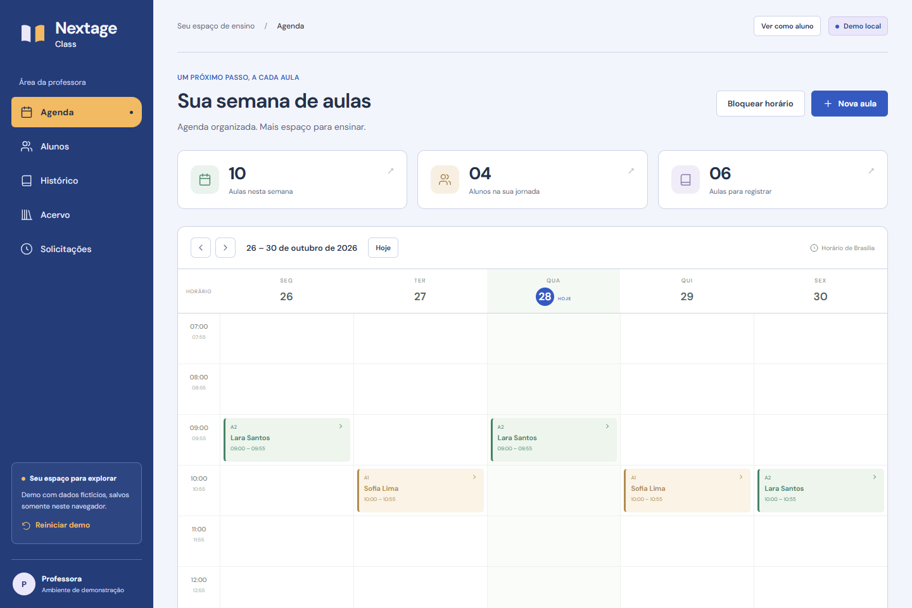

# Nextage Class

Agenda e acompanhamento pedagógico para professores particulares de idiomas. Organize os encontros, retome o conteúdo de cada aluno e registre o que foi estudado, conectando a rotina antes e depois da aula.

## Experimente a demo local

**A demo ainda não tem uma versão online publicada.** [Execute localmente](#executar-localmente) para experimentar com alunos e materiais fictícios, sem configurar conta ou servidor. A demo permite alternar entre a professora e a consulta simulada do aluno.



Captura da demo com dados fictícios e da revisão visual local de 27/10/2026. Essa revisão de interface ainda tem publicação pendente; o piloto com contas e persistência no servidor é uma entrega separada.

## O que você pode fazer

- Organizar alunos, agenda semanal, bloqueios e remarcações individuais ou recorrentes.
- Preparar e registrar encontros, preservando o conteúdo usado e a continuidade por aluno e sequência didática.
- Organizar livros, aulas próprias, unidades numeradas e materiais de apoio por nível.
- Registrar homework e sua correção, consultando o histórico de cada encontro.
- Simular a visão do aluno com próximas aulas, histórico permitido e acervo do nível atual.
- Enviar pedidos avulsos e semanais pela simulação do aluno e aprovar ou recusar pela professora. Um pedido pendente não reserva horário.

As etapas 1 e 2 foram aprovadas na revisão com Nara, a professora de referência, conforme registros de Cristian em 24 e 25/10/2026. [Escopo e decisões](docs/decisions.md).

## Stack e decisões

| Parte               | Escolha e motivo                                                                                         |
| ------------------- | -------------------------------------------------------------------------------------------------------- |
| Demo e interface    | React, TypeScript e Vite; regras de agenda e histórico separadas dos componentes.                        |
| Piloto com servidor | ASP.NET Core/C# e PostgreSQL; Supabase para banco hospedado e autenticação, com regras de acesso na API. |
| Qualidade           | Zod, Vitest, Playwright e OpenSpec proporcional; evidências técnicas separadas do aceite de uso.         |

Uma unidade do material não equivale a um encontro da agenda. Histórico, progresso e disponibilidade têm contratos próprios. A simulação local não oferece autenticação nem isolamento seguro por conta. [Arquitetura e limites](docs/architecture.md).

## Executar localmente

Requer Git, Node.js 24+ e npm. Para a demo:

```sh
git clone https://github.com/cristianworth/nextage-class.git
cd nextage-class
npm ci
npm --prefix web ci
npm run dev
```

Abra **http://127.0.0.1:5173**. Os exemplos e alterações ficam neste navegador. A execução do servidor C# e do piloto autenticado tem [instruções próprias](docs/server-development.md); ela não é necessária para a demo.

## Estado e próximos passos

Demo das etapas 1 e 2 entregue. Base ASP.NET Core/PostgreSQL executável; cadastro, convites e telas de acesso implementados, com conferência integrada real do 3B ainda pendente. Rotina completa persistida e operação do piloto seguem no [roadmap](docs/roadmap.md). A demo pública ainda precisa ser hospedada.

O projeto é desenvolvido com assistência de IA. Cristian guia o produto, define prioridades e acompanha decisões; Nara valida a rotina de ensino. A IA participa do desenvolvimento, sem recursos de IA no produto. [Visão e processo](docs/product-vision.md).

## Verificação e documentação

```sh
npm test
npm run build
npm run format:check
npm run test:e2e
```

- [Mapa da documentação](docs/README.md): guias atuais e evidências históricas.
- [Desenvolvimento local](docs/local-development.md): ambiente e verificações.
- [Identidade visual](docs/visual-design.md): marca, tipografia e referências.
- [Verificação da etapa 2](docs/verification-2d.md) e [estado do 3B](docs/verification-3b.md).

Relate problemas ou propostas nas [issues](https://github.com/cristianworth/nextage-class/issues), com exemplos fictícios. A licença de distribuição ainda precisa ser definida; não há LICENSE na raiz. Código, interface e acervo privado de outros sistemas não fazem parte do projeto.
